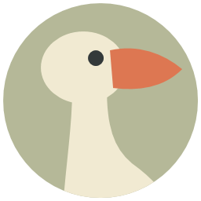
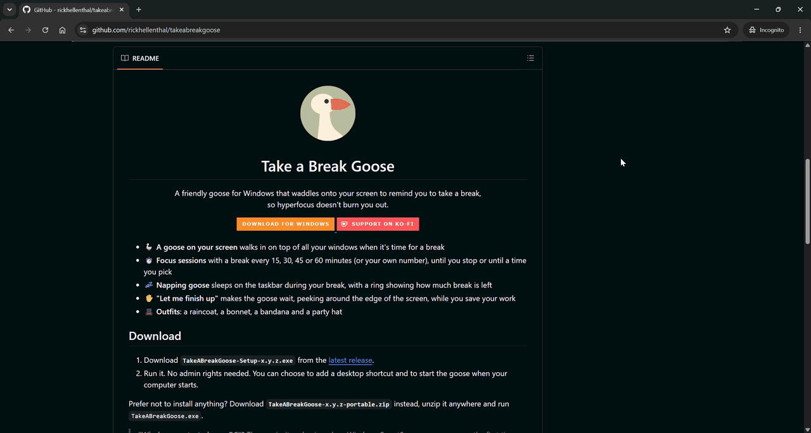
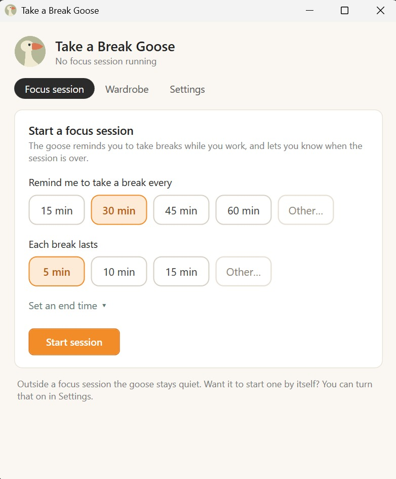

<p align="center">
  
</p>

<h1 align="center">Take a Break Goose</h1>

<p align="center">
  A friendly goose for Windows and macOS that waddles onto your screen to remind you to take a break,<br>
  so hyperfocus doesn't burn you out.
</p>

<p align="center">
  <a href="https://github.com/rickhellenthal/takeabreakgoose/releases/latest">
    
  </a>
  <a href="#on-a-mac">
    
  </a>
  <a href="https://ko-fi.com/rickhellenthal">
    
  </a>
</p>

<p align="center">
  
</p>

- 🪿 **A goose on your screen** walks in on top of all your windows when it's time for a break
- ⏱️ **Focus sessions** with a break every 15, 30, 45 or 60 minutes (or your own number), until you stop or until a time you pick
- 💤 **Napping goose** sleeps on the taskbar during your break, with a ring showing how much break is left
- ✋ **"Let me finish up"** makes the goose wait, peeking around the edge of the screen, while you save your work
- 🎩 **Outfits**: a raincoat, a bonnet, a bandana and a party hat

## Download

### On Windows

1. Download **`TakeABreakGoose-Setup-x.y.z.exe`** from the [latest release](https://github.com/rickhellenthal/takeabreakgoose/releases/latest).
2. Run it. No admin rights needed. You can choose to add a desktop shortcut and to start the goose when your computer starts.

Prefer not to install anything? Download **`TakeABreakGoose-x.y.z-portable.zip`** instead, unzip it anywhere and run `TakeABreakGoose.exe`.

> **"Windows protected your PC"?** The app isn't code-signed, so Windows SmartScreen may warn you the first time. Click **More info**, then **Run anyway**.

To uninstall, go to *Settings → Apps → Installed apps* and remove **Take a Break Goose**.

### On a Mac

> [!NOTE]
> The Mac version is an extra. It's made on Windows and we can't test it on a Mac ourselves, so use it with care: bugs are more likely than on Windows. Found one? Please [open an issue](https://github.com/rickhellenthal/takeabreakgoose/issues).

1. Download the file for your Mac from the [latest release](https://github.com/rickhellenthal/takeabreakgoose/releases/latest): **`…-mac-apple-silicon.dmg`** for a Mac with an Apple chip (M1 or later), **`…-mac-intel.dmg`** for an Intel Mac. Not sure? Apple menu  → **About This Mac**.
2. Open it and drag **Take a Break Goose** onto **Applications**.
3. Open it from Applications. The goose lives in the menu bar, not in the Dock. It needs macOS 12 or later.

**"Take a Break Goose can't be opened"?** The app isn't signed by Apple, so macOS blocks it the first time. Open **Terminal** and run this once; after that it opens like any other app:

```bash
xattr -dr com.apple.quarantine "/Applications/Take a Break Goose.app" && open "/Applications/Take a Break Goose.app"
```

Or, if macOS offers it: **System Settings → Privacy & Security**, scroll down and click **Open Anyway**.

To uninstall, quit the goose from its menu bar icon and drag it from Applications to the Trash.

## How it works

Open the goose with **Ctrl+Alt+G**, the Start menu, or by clicking its icon in the system tray. On a Mac: **⌃⌥G** (Control+Option+G), or its icon in the menu bar. There the goose naps just above the Dock instead of on the taskbar.

<p align="center">
  
</p>

1. **Start a focus session.** Pick how often you want a break and how long your breaks are (down to the second, for quick eye breaks), then click **Start session**. The goose remembers your choices for next time. Want it to stop at a certain point? Click **Set an end time** to end it after a while (like 2 hours) or at a time of day (like 17:00).
2. **The goose arrives** when it's break time. You can:
   - take the break with **Okay, break time!**
   - say **Let me finish up**: the goose waits at the edge of the screen until you click it
   - **snooze** it for a few minutes (you can turn this off in Settings)

   The goose waits as long as it takes for an answer.
3. **During your break** the goose naps on the taskbar. Need to cut the break short? Click it. It's not thrilled about being woken up, but it'll let you. Still using your computer instead? The goose half wakes up, and if you keep at it, it asks whether you're actually taking your break.
4. **When you're back**, the goose wakes up and asks if you're ready to focus. The countdown to your next break only starts once you say so.

Away from your computer for at least 5 minutes, or your whole break if it's longer, for example at lunch or while the goose was waiting? That counts as your break. The countdown to the next one starts fresh when you're back.

In a meeting? The goose stays away during calls by itself: when your camera is in use, or when a meeting app like Teams, Zoom or Google Meet uses your microphone, **Do not disturb** turns on, and it turns off again when the call is over. Voice chat in games and Discord doesn't count, so the goose still comes by while you're gaming. You can turn this off in Settings, or turn Do not disturb on yourself in your session (or from the tray icon).

While Do not disturb is on, your timer keeps running, but the goose stays away. A break that comes up in the meantime waits until Do not disturb is off again. Want to show the goose to someone during a call? Turn Do not disturb off, and it stays off until the call is over.

When a session reaches its end time, the goose drops by in its party hat to sign off. (In Do not disturb, it waits until you turn that off.) Outside a focus session it stays quiet.

The **Wardrobe** tab shows the goose's outfits. It picks one at random for each visit, or you can send a goose over to show off the outfit of your choice. That's just for fun, so it doesn't affect your session's timer.

## Settings

- **Start with Windows**, and **start a focus session automatically** when the app starts, so the goose keeps an eye on you without you having to do anything
- **Do not disturb during calls**, on unless you turn it off
- **Snooze length**, or turn snoozing off altogether
- **The shortcut** that opens the app, and **the messages** the goose picks from

Your settings are saved in `%APPDATA%\TakeABreakGoose\settings.json`. At the bottom of the Settings tab you can see which version you have, and whether a newer one is available.

## Support

The goose is free to use. If it helps you like it helps me and you would like to contribute a little, I have a link where you can buy me a coffee ☕

<a href="https://ko-fi.com/N7T029W6PF" target="_blank"></a>

Full disclosure: as you can probably tell, I built this app with the help of [Claude](https://claude.ai), Anthropic's AI assistant.

<details>
<summary><b>Building from source</b></summary>

You need the [.NET 8 SDK](https://dotnet.microsoft.com/download/dotnet/8.0).

```bash
dotnet run
```

Add `-- --summon` to make the goose appear right away, which is handy for testing. To run the tests:

```bash
dotnet test tests/TakeABreakGoose.Tests
dotnet test tests/TakeABreakGoose.Windows.Tests
```

What the goose does without any windows lives in `Core/`, a plain .NET library: `Sessions/` (when breaks are due), `Settings/` (the settings and their file), `Goose/` (which visit comes when, the outfits, the nap watch) and the texts it shows. The Windows app around it is grouped by area: `Goose/` (the goose and its visits), `Settings/` (starting with Windows), `Windows/` (the app window, its pages and dialogs) and `Platform/` (tray icon, shortcut, Windows integration). `tests/TakeABreakGoose.Tests` tests the core, `tests/TakeABreakGoose.Windows.Tests` the Windows-only parts. A macOS app on the same core is on its way in `Mac/` (Avalonia); see [docs/macos-port.md](docs/macos-port.md). The app icon is generated by `tools\make-icon.ps1`, and installers are built automatically by the [release workflow](.github/workflows/release.yml), which runs the tests first.

</details>
