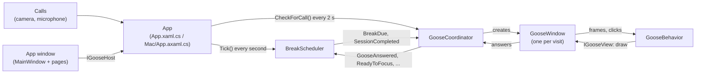

# Architecture

Take a Break Goose is two desktop apps around one shared core, all in C# on .NET 8:

| Project | Target | What it is |
|---|---|---|
| `Core/TakeABreakGoose.Core.csproj` | `net8.0` | Everything the goose decides, without any windows: plain .NET, so both apps share it and its tests run anywhere |
| `TakeABreakGoose.csproj` (repository root) | `net8.0-windows` | The Windows app, in WPF (plus WinForms for the tray icon) |
| `Mac/TakeABreakGoose.Mac.csproj` | `net8.0` | The macOS app, in [Avalonia](https://avaloniaui.net/). It also builds and runs on Windows, for trying it out |
| `tests/TakeABreakGoose.Tests` | `net8.0` | Tests for the core |
| `tests/TakeABreakGoose.Windows.Tests` | `net8.0-windows` | Tests for the Windows-only parts |

Both apps take their version from `Directory.Build.props`.

## The core

```
Core/
├── Sessions/    when breaks are due: BreakScheduler, WorkSession, SessionPlan, BreakRecord,
│                SessionSummary, CallDoNotDisturb, GooseOutcome
├── Goose/       what the goose does on screen: GooseCoordinator, GooseBehavior, NapWatch,
│                GooseVisit, GooseOutfits, NapLook, and the IGooseWindow / IGooseView interfaces
├── Settings/    GooseSettings (what's in settings.json) and SettingsStore (reading and writing it)
├── AppWindow/   IGooseHost (what the app window may ask of the app), EditableMessage
├── Platform/    what the core needs from the computer: IClock and IUserActivity
├── Text/        TimeText: durations in words ("5 min", "1 min 30 sec", "about 20 minutes")
└── Updates/     UpdateChecker: asks GitHub whether a newer release is out
```

The core has no timers and no threads of its own. Each app calls `BreakScheduler.Tick()` every
second and `GooseBehavior.NextFrame()` every frame, on its UI thread, so every event is raised
where the windows can handle it. The current time and the time since the last mouse or keyboard
input come in through `IClock` and `IUserActivity`, which is what lets the tests run hours of a
session in milliseconds with a fake clock.

## The main pieces



- **`BreakScheduler`** keeps the session's state: when the next break is due, whether the user is
  on a break, away, or in Do not disturb, and which breaks were taken. It raises `BreakDue` when
  it's time for the goose, and `SessionCompleted` when a session reaches its end time.
- **`GooseCoordinator`** directs the visits. It turns `BreakDue` into a break reminder, makes sure
  only one goose is on screen at a time (a visit that mustn't get lost waits for the current one to
  leave), passes the user's answers back to the scheduler, and turns Do not disturb on and off for
  calls. It creates each visit's window through a factory, so it doesn't know about WPF or Avalonia.
- **`GooseBehavior`** is one visit: walking in, asking, peeking at the screen edge, napping and
  walking out. It's a state machine driven by frames and clicks, and draws through `IGooseView`.
  See [How the goose decides](break-logic.md).
- **`GooseWindow`** (one per app) is the transparent, always-on-top window. It draws the goose
  (`GooseFigure`), the speech bubble and the break card, and passes frames and clicks on to its
  `GooseBehavior`. It implements both `IGooseView` (for the behaviour) and `IGooseWindow` (for the
  coordinator).
- **The app window** (`Windows/` and `Mac/Windows/`) has three tabs: Focus session, Wardrobe and
  Settings, plus a Messages page. It only talks to the app through `IGooseHost`.

## Each app

The two apps are laid out the same way:

| | Windows | macOS |
|---|---|---|
| Startup, wiring, single instance | `App.xaml.cs` | `Mac/App.axaml.cs`, `Mac/Program.cs` |
| The goose's window and drawing | `Goose/` | `Mac/Goose/` |
| App window, pages, dialogs, styles | `Windows/` | `Mac/Windows/` |
| What it needs from the operating system | `Platform/`, `Settings/Autostart.cs` | `Mac/Platform/` |

At startup the app loads the settings, creates the `BreakScheduler` and `GooseCoordinator`, starts
the one-second tick and the two-second call check, registers the global shortcut, creates the tray
or menu bar icon, and starts a session right away when **Start a focus session when the app
starts** is on. See [Platform integration](platform.md) for the operating system parts.

## Settings

`GooseSettings` is serialized to `settings.json` with `System.Text.Json`, in the folder each app
passes to `SettingsStore`:

- Windows: `%APPDATA%\TakeABreakGoose\settings.json`
- macOS: `~/Library/Application Support/TakeABreakGoose/settings.json`

A missing or corrupt file gives the defaults. `GooseSettings.Sanitize()` runs after every load
and clamps values to sensible ranges.

**Renamed or replaced settings** stay readable so nobody loses their choices on update: the old
property is kept as a nullable with `[JsonIgnore(Condition = WhenWritingNull)]`, `Sanitize()`
carries its value over to the new property and clears it, and the app saves the file right after
loading. For example, `BreakMinutes` (a default break length in whole minutes) became
`LastSessionBreakSeconds`. The tests in `GooseSettingsTests` check that older files still load.

The start form remembers the last session's choices (`LastSession…`), and sessions that start
automatically use the same break length.

## Updates

`UpdateChecker` asks the GitHub API for the latest release once per run, and compares its tag with
the app's own version. When a newer one is out, the Settings tab shows a quiet link to it. Offline
or anything unexpected simply means no news. There's no automatic updating: the user downloads the
new installer.
