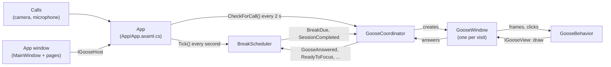

# Architecture

Take a Break Goose is one desktop app for Windows and macOS around a core without any windows, all
in C# on .NET 8:

| Project | Target | What it is |
|---|---|---|
| `Core/TakeABreakGoose.Core.csproj` | `net8.0` | Everything the goose decides, without any windows: plain .NET, so its tests run anywhere |
| `App/TakeABreakGoose.App.csproj` | `net8.0` | The app, in [Avalonia](https://avaloniaui.net/): the same windows and pages on Windows and macOS, with what each operating system needs in `App/Platform/` |
| `tests/TakeABreakGoose.Tests` | `net8.0` | Tests for the core |
| `tests/TakeABreakGoose.Windows.Tests` | `net8.0-windows` | Tests for the app's Windows-only parts |

The app takes its version from `Directory.Build.props`. Until 1.9.0, Windows had an app of its own
in WPF; see [One app](avalonia-on-windows.md) for how it was replaced.

## The core

```
Core/
├── Sessions/    when breaks are due: BreakScheduler, WorkSession, SessionPlan, BreakRecord,
│                SessionSummary, CallDoNotDisturb, GooseOutcome
├── Goose/       what the goose does on screen: GooseCoordinator, GooseBehavior, NapWatch,
│                GooseVisit, GooseOutfits, NapLook, and the IGooseWindow / IGooseView interfaces
├── Settings/    GooseSettings (what's in settings.json) and SettingsStore (reading and writing it)
├── AppWindow/   IGooseHost (what the app window may ask of the app), EditableMessage
├── Platform/    what the core needs from the computer: IClock and IUserActivity
├── Text/        every text the app shows, in English and Dutch (Strings.resx, Strings.nl.resx),
│                Languages (which one the app speaks), and TimeText: durations in words
│                ("5 min", "1 min 30 sec", "about 20 minutes")
└── Updates/     what's needed to update: when to check (UpdateSchedule), when not to restart
                 (UpdateMoment), the release notes in short (ReleaseNotes, ReleaseHistory, WhatsNew),
                 and UpdateChecker for a copy that can't update itself
```

The core has no timers and no threads of its own. The app calls `BreakScheduler.Tick()` every
second and `GooseBehavior.NextFrame()` every frame, on its UI thread, so every event is raised
where the windows can handle it. The current time and the time since the last mouse or keyboard
input come in through `IClock` and `IUserActivity`, which is what lets the tests run hours of a
session in milliseconds with a fake clock.

## The main pieces



- **`BreakScheduler`** keeps the session's state: when the next break is due, whether the user is
  on a break, away, or in Do not disturb, and which breaks were taken. It raises `BreakDue` when
  it's time for the goose, and `SessionCompleted` when a session reaches its end time.
- **`GooseCoordinator`** directs the visits. It turns `BreakDue` into a break reminder, makes sure
  only one goose is on screen at a time (a visit that mustn't get lost waits for the current one to
  leave), passes the user's answers back to the scheduler, and turns Do not disturb on and off for
  calls. It creates each visit's window through a factory, so it doesn't know about Avalonia.
- **`GooseBehavior`** is one visit: walking in, asking, peeking at the screen edge, napping and
  walking out. It's a state machine driven by frames and clicks, and draws through `IGooseView`.
  See [How the goose decides](break-logic.md).
- **`GooseWindow`** is the transparent, always-on-top window. It draws the goose
  (`GooseFigure`), the speech bubble and the break card, and passes frames and clicks on to its
  `GooseBehavior`. It implements both `IGooseView` (for the behaviour) and `IGooseWindow` (for the
  coordinator).
- **The app window** (`App/Windows/`) has three tabs: Focus session, Wardrobe and
  Settings, plus a Messages page. It only talks to the app through `IGooseHost`.

## The app

| | |
|---|---|
| Startup, wiring, single instance | `App/App.axaml.cs`, `App/Program.cs` |
| The goose's window and drawing | `App/Goose/` |
| App window, pages, dialogs, styles | `App/Windows/` |
| What it needs from the operating system | `App/Platform/`: one class per job (`Calls`, `HotkeyManager`, `StatusIcon`, ...) that picks `Platform/Windows/` or `Platform/MacOS/` |

At startup the app loads the settings, creates the `BreakScheduler` and `GooseCoordinator`, starts
the one-second tick and the two-second call check, registers the global shortcut, creates the tray
or menu bar icon, and starts a session right away when **Start a focus session when the app
starts** is on. See [Platform integration](platform.md) for the operating system parts.

## Settings

`GooseSettings` is serialized to `settings.json` with `System.Text.Json`, in the folder the app
passes to `SettingsStore`:

- Windows: `%APPDATA%\TakeABreakGoose\settings.json` (`TakeABreakGoose.Debug` for a Debug build)
- macOS: `~/Library/Application Support/TakeABreakGoose/settings.json`

A missing or corrupt file gives the defaults. `GooseSettings.Sanitize()` runs after every load
and clamps values to sensible ranges.

**Renamed or replaced settings** stay readable so nobody loses their choices on update: the old
property is kept as a nullable with `[JsonIgnore(Condition = WhenWritingNull)]`, `Sanitize()`
carries its value over to the new property and clears it, and the app saves the file right after
loading. For example, `BreakMinutes` (a default break length in whole minutes) became
`LastSessionBreakSeconds`. The tests in `GooseSettingsTests` check that older files still load.

The start form remembers the last session's choices (`LastSession…`), and sessions that start
automatically use the same break length.

## Languages

The app speaks English (the default) or Dutch, picked under **Language** in Settings and saved as
`Language` in settings.json (`"en"` or `"nl"`; anything else becomes English).

- **The texts** live in the core, in `Core/Text/Strings.resx` (English) and `Strings.nl.resx`
  (Dutch, with the same names). The build turns them into the `Strings` class, with a property per
  text, and puts the Dutch ones in a satellite assembly (`nl/TakeABreakGoose.Core.resources.dll`,
  bundled into the single-file `.exe`). The core, the app and the tests all use `Strings`:
  - In code: `Strings.GooseHonk`, or `string.Format(Strings.GooseSnooze, minutes)` for a text with
    placeholders. Clock times are placeholders too (`{0:HH:mm}`), so they stay on the 24-hour clock.
  - In XAML: `Text="{x:Static s:Strings.SessionStart}"`, with `xmlns:s="using:TakeABreakGoose"`.
  - Counts and plurals have a text for one and one for more (`WordsMinuteOne` "1 minute",
    `WordsMinuteMany` "5 minutes"), which `TimeText` and `SessionSummary` pick from. Lists, like the
    goose's lines and the number words, are one text with an item per line (`Languages.Lines`).
- **Which language** the texts are in is `Languages.Current`, one setting for the whole app
  (`Strings.Culture`). It's English from the start, also before the settings are loaded and in the
  tests, rather than following the computer's own language. The app calls `Languages.Use(...)`
  with the saved language at startup, and again when it's changed in Settings.
- **Switching** applies right away when Settings is saved: the tray or menu bar menu and the status
  update, the next goose speaks the new language, and the app window is swapped for a new one in the
  same place, back on Settings (`ReopenMainWindow` in `App`). XAML texts are read once, when a
  window opens, so a new window is the simple way to show them all in the new language. A goose
  that's on screen at that moment finishes its visit in the old one.
- **The messages** the goose picks from are the user's own list, so they aren't texts in `Strings`,
  but the list starts as the goose's default messages (`DefaultMessages` in the resources, in the
  same order in every language). `GooseSettings.TranslateDefaultMessages()` puts every message that
  is still exactly one of the defaults, in any language, in the settings' language; messages the
  user wrote or changed are left alone. It runs when the language changes and on every load (so a
  hand-edited file catches up too). **Reset to defaults** gives the defaults in the current language.

## Updates

The app updates itself with [Velopack](https://velopack.io), from the GitHub releases
(`App/Platform/Updater.cs`). The app (`App`) checks a minute after starting, every 12 hours, and when
the window opens unless it just did (`UpdateSchedule`). What it finds shows up in the Settings tab, in
the tray or menu bar menu, and once in a notice. Updating downloads the new version with a progress
card over the window, then restarts; it waits while the goose is busy (`UpdateMoment`). The new
version then shows what's new once, from the release notes of every version since the old one.

A copy that Velopack didn't install (a Debug build, or one from before 1.11) can't update itself;
`UpdateChecker` only finds the newer release and links to it. See [In-app updates](in-app-updates.md)
for the whole story, from the release workflow to the restart.
