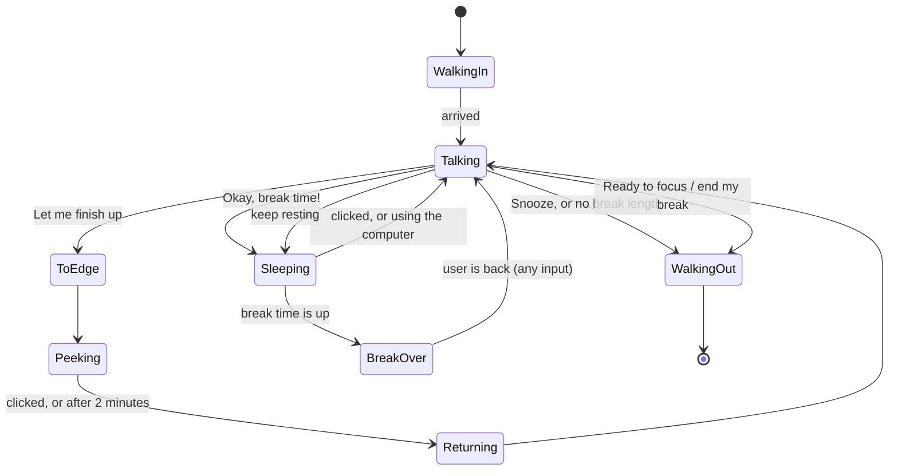

# How the goose decides

All of this lives in the shared core, so the Windows and macOS apps behave the same. The two
main classes are `BreakScheduler` (`Core/Sessions/`), which keeps the session's state, and
`GooseBehavior` (`Core/Goose/`), which runs one goose visit on screen. `GooseCoordinator` sits
between them.

## Focus sessions

The goose only comes by during a focus session. Outside one it stays quiet.

A session (`WorkSession`) has:

- an **interval**: minutes between reminders
- a **break length** (`TimeSpan`, down to the second). Zero means no breaks are counted: the goose
  reminds you, then walks off.
- optionally an **end**: after a number of minutes, or at a time of day (`SessionPlan` works out
  the end time, and rolls a time that has already passed over to tomorrow)

A session starts from the Focus session tab, or by itself when the app starts if **Start a focus
session when the app starts** is on. Sessions that start by themselves have no end, and use the
remembered break length.

## The countdown

`BreakScheduler.NextBreakAt` is when the next reminder is due. It's set to *now + interval* when:

- a session starts
- the user says they're ready to focus after a break
- the user answers the goose without taking a break (only possible with a break length of zero)
- the user comes back after being away long enough for it to count as a break (see below)

A snooze sets it to *now + snooze minutes* instead. While the goose is on screen, or the user is on
a break, there is no countdown at all: the next one only starts once they're ready to focus again.

Every second, `Tick()` checks whether it's time. When it is, it raises `BreakDue`, unless Do not
disturb is on (the break then waits, see below) or the user is away.

## A goose visit

`GooseCoordinator.SummonBreakGoose()` picks one of the user's messages at random and creates a
goose window. Only one goose is ever on screen: a reminder that comes while a goose is just showing
off an outfit, or a session's goodbye, waits until the current goose has left.

`GooseBehavior` then runs the visit as a state machine. `Phase` is what the goose is doing, and
`Question` is what its speech bubble is asking.

### Asking for a break

The bubble shows the message, a hint like *"Take 5 minutes. I'll start counting again after
that."*, and three answers:

| Answer | What happens |
|---|---|
| **Okay, break time!** | The break starts: the goose naps for the break's length |
| **Let me finish up** | The goose walks to the screen edge and peeks around it |
| **Snooze *n* min** (a link, only when snoozing is allowed in Settings) | The goose walks off; it's back after the snooze length |

There's no timeout: **a goose that's ignored stays and waits** for an answer, and no new countdown
starts in the meantime.

### Finishing up

While the goose peeks at the screen edge, clicking it brings it back to ask again: *"All finished up
and saved? Then you're ready for your break!"*. If nobody clicks it for **2 minutes**
(`GooseBehavior.FinishUpReminder`), it comes back by itself: *"Done finishing up? Your break is
waiting for you!"*. **Let me finish up** is offered every time it asks, and each time the 2 minutes
start over.

### The nap

During the break the goose naps on the taskbar (above the Dock on a Mac), with a ring showing how
much of the break is left. `NapWatch` (`Core/Goose/NapWatch.cs`) keeps an eye on the mouse and
keyboard meanwhile:

- The first **5 seconds** don't count, so the click that started the break, or a last bit of
  typing, doesn't wake the goose.
- Using the computer makes it **stir**: head up, one eye open. Leaving the computer alone for
  **4 seconds** lets it doze off again.
- After **6 seconds** of use in total, it asks *"Psst… are you actually taking your break?"*, with
  **I'm going!** and **End my break**. Left unanswered for **20 seconds** without any input (the
  user got up after all), it goes back to sleep.

Clicking the napping goose wakes it up, grumpily: *"Hey! I was napping…"*, with **Keep resting**
and **End my break**. Ending the break, from here or from the "Psst" question, takes one more
confirmation (*"Really?"*). The goose then walks off with its beak in the air, and the break counts
as ended early.

### After the break

When the break time is up, the goose keeps napping until the user is back: the first input after
the break's end wakes it up. It then asks whether they're ready to focus, with **Ready to focus**
and ***n* more minutes** (the snooze length), which naps a bit longer.

**Ready to focus** ends the visit and starts the next countdown. The scheduler records the break
(`BreakRecord`) as *Taken* or, if it was cut short, *Ended early*.

## Being away counts as a break

The goose can't tell whether you look away from the screen, only whether you touch the mouse or
keyboard (`IUserActivity.IdleTime()`). So being away only counts once it's long enough to really be
a break: **at least the break's length, and at least 5 minutes**
(`BreakScheduler.AwayCountsAsBreakAfter` and `MinimumAway`). Shorter idle time is too often reading
or watching a video.

- **During the countdown:** after that long without input, the scheduler marks the user as away
  (*"Away from the keyboard"*) and no reminder comes. When they're back, the time away is recorded
  as a break (*Away*), and a fresh countdown starts.
- **While the goose asks, or peeks while you finish up:** only the time since the goose first asked
  counts, so sitting still before it showed up isn't a break. When the user is back after long
  enough, the goose skips the nap: *"Looks like you already took a break while I waited. Ready to
  focus again?"*

## Do not disturb

Do not disturb only exists during a session. It's turned on by the user (on the Focus session tab
or from the tray or menu bar icon), or automatically during a call.

- **The countdown keeps running.** A break that comes due waits (`BreakWaiting`) and the goose
  comes as soon as Do not disturb is turned off.
- **A goose on screen leaves right away** when it's turned on. If it was still asking for a break,
  that break waits for Do not disturb to end too. If the user was already on the break, the break
  ends and the next countdown starts, since being in a meeting means being back at work.
- **Stopping the session** turns it off.

### During calls

Every 2 seconds the app checks whether the user is in a call: a camera is in use, or a meeting app
uses the microphone (see [Platform integration](platform.md#calls)). `CallDoNotDisturb` then
decides:

- A call during a session turns Do not disturb on, if **Turn on Do not disturb during calls** is
  on in Settings.
- When the call is over, it turns off again, but only if the call turned it on.
- If the user turns it off during the call (to show someone the goose), it stays off until that
  call is over.

The first time this happens, a notification explains it (`CallNoticeShown`).

## The end of a session

When a session reaches its end time, and no goose is on screen, the scheduler ends it and raises
`SessionCompleted`. The goose then comes by in its party hat to say goodbye, with how long the
session was and a sentence about the breaks (`SessionSummary`), like *"You took three breaks along
the way, about 20 minutes of rest."*. During Do not disturb, the goodbye waits until it's turned
off (`SignOffWaiting`).

## Visits just for fun

Sending a goose from the Wardrobe tab (`GooseCoordinator.ShowOffOutfit`) is a *just visiting*
goose: it shows off its outfit and leaves, without touching the scheduler. A reminder that comes
due meanwhile waits until it has left.

## The status line

`BreakScheduler.Describe()` gives the one-line status shown in the window header and the tray
tooltip, such as *"Focus session · next break at 14:30"*, *"On a break until 14:35"*, *"In a call ·
a break is waiting"* or *"Away from the keyboard"*.
